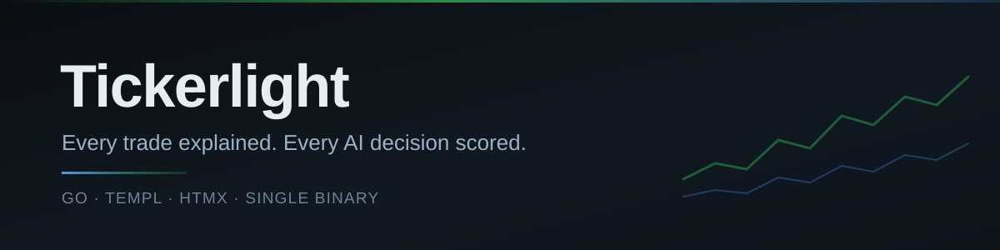
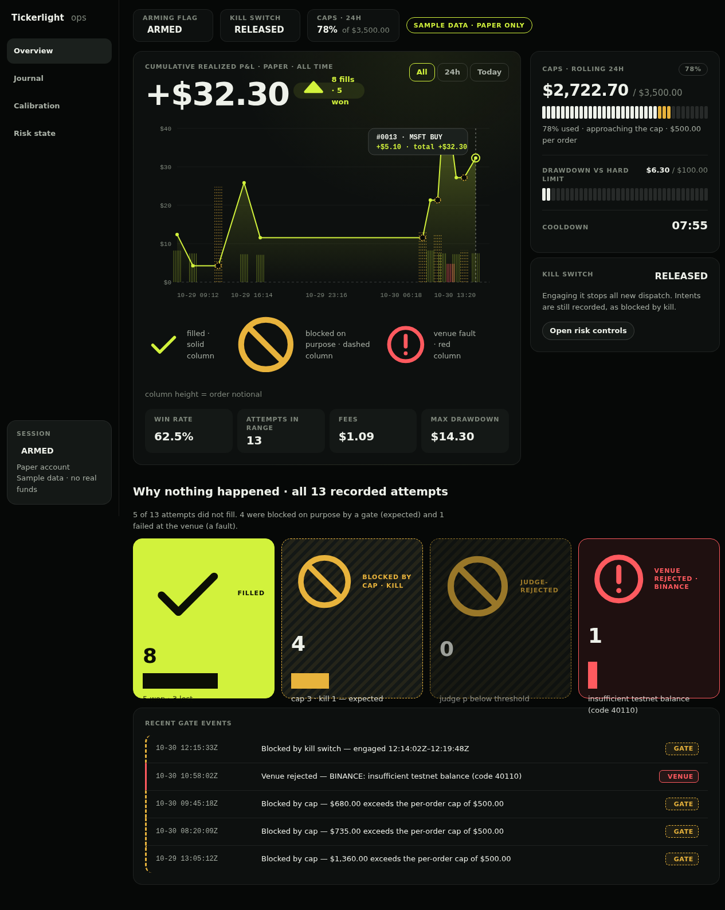
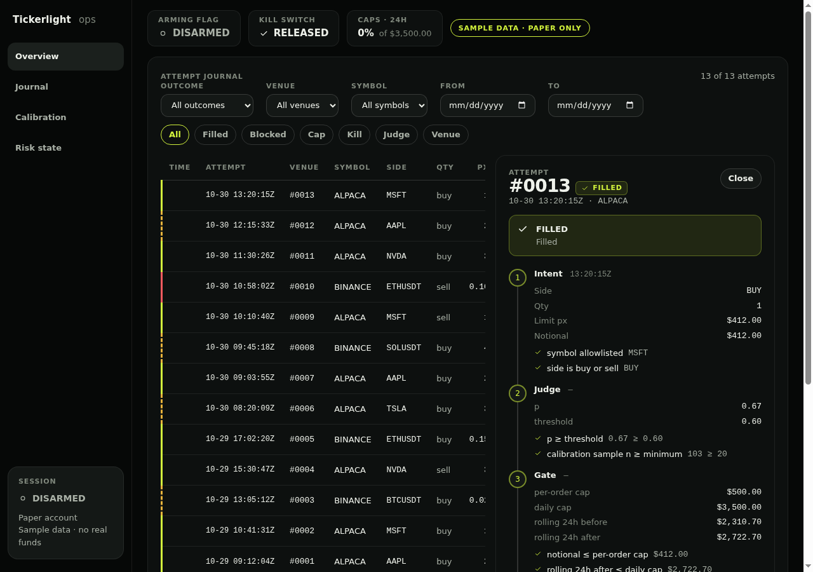
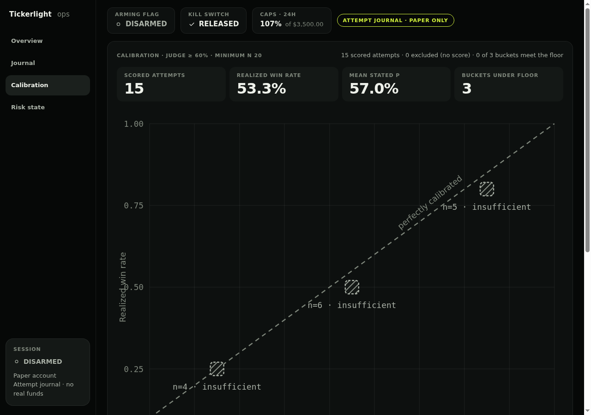
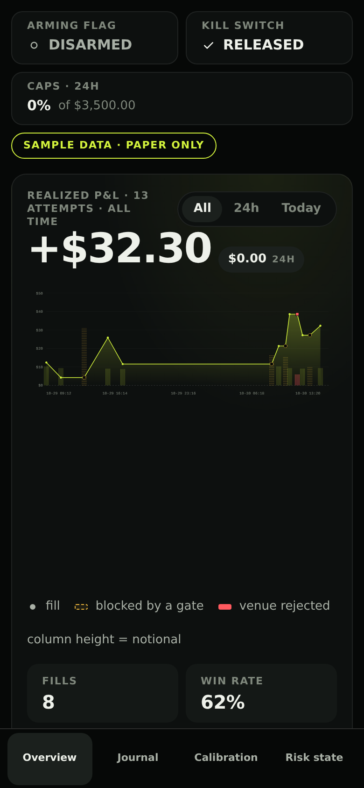

<div align="center">



<p align="center">
  
  
  
  
  
  
  
</p>

</div>

## Table of Contents

- [Demo](#demo)
- [What is it?](#what-is-it)
- [Features](#features)
  - [Trade performance](#trade-performance)
  - [Decision trace](#decision-trace)
  - [AI calibration](#ai-calibration)
  - [Risk visibility](#risk-visibility)
  - [Deployment](#deployment)
  - [Mobile review](#mobile-review)
- [Quickstart](#quickstart)
- [Current status](#current-status)
- [Documentation](#documentation)
- [License](#license)

## Demo



## What is it?

Tickerlight is a self-hosted console for reviewing what your trading system did, and why. It puts
trade outcomes, the decision chain behind each attempt, AI judge calibration, and live risk
headroom in one place — served as plain HTML from a single Go binary.

Most dashboards show you what happened. Tickerlight shows you why — and whether the AI that made
the call was actually right.

## Features

### Trade performance

Realized P&L, fills, win rate, max drawdown, and fees across any window you care about — all
rendered from the same ledger that feeds the journal, so the numbers can't drift apart.

### Decision trace

Pick an attempt and walk the chain: what was intended, what the judge scored it, which gate
stopped it, what the venue said. Blocks stop looking like outages and start looking like the
system working.



### AI calibration

A calibration view plots the judge's stated probability against realized win rate, bucket by
bucket. The buckets come from the attempt journal itself: attempts that reached a venue are
grouped into tenths of a point of stated probability, and every bucket reports its n beside its
win rate. Attempts the journal recorded without a score are left out and counted, so a missing
score never reads as a confident zero. Gate refusals stay out of the buckets too — an attempt the
judge or a cap stopped never had the chance to fill, and counting it as a loss would flatter the
low end of the curve. Minimum-sample floors mean thin buckets can't quietly promote a model that
only looks confident. This is the part you can't get from a P&L chart.



### Risk visibility

Rolling 24h exposure against daily and per-order caps, drawdown versus limit, cooldown, and every
pre-trade check visible with the value it compared.

### Live policy

The Policy panel reads the engine's own numbers instead of restating the sample ledger's: caps, the
remaining headroom, mode, judge threshold and alert-sink status all come from the engine's
`caps_status` tool over the loopback MCP endpoint — one response, one source of truth. It is
read-only by construction — the console calls `caps_status` and nothing else, and has no surface
that can arm, size, place, cancel or kill. When the engine does not answer, the panel says so and
shows no numbers rather than a plausible zero; a field the engine does not report renders as
`not reported` rather than as a default.

### Deployment

Go `net/http` and server-rendered templ, with HTMX swapping panels in place. No SPA, no client
router, no `node_modules`, no CDN dependency at runtime. One static binary that starts instantly
and serves HTML.

### Mobile review

The same console, reflowed for a phone — because the moment you want to check exposure is rarely
the moment you're at your desk.

<p align="center">
  
</p>

## Quickstart

Requires Go 1.27+ and `templ`:

```sh
go install github.com/a-h/templ/cmd/templ@v0.3.1100
templ generate
go run ./cmd/tickerlight
```

Then open <http://localhost:8080>.

To render a real attempt journal instead of the sample ledger, point the console at the JSONL file
the trading server writes:

```sh
go run ./cmd/tickerlight --journal /path/to/journal.jsonl
```

The file is read-only to this binary and a torn final line (a crash mid-write) is skipped rather
than failing the read. Without the flag the console serves the sample ledger exactly as before; a
path that cannot be read is a startup error, never a silent fallback to sample trades.

Beside the journal the console also reads the engine's status snapshot — `status.json` in the same
directory, or `--status` to point elsewhere:

```sh
go run ./cmd/tickerlight --journal /path/to/journal.jsonl --status /path/to/status.json
```

The snapshot is how the console stops guessing which engine it is drawing. It carries
`mode` (`live` or `paper`), `armed`, `kill`, `per_order_cap_cents`, `daily_cap_cents`,
`daily_spent_cents`, `daily_remaining_cents`, `judge_threshold` and `updated_at`. The corner badge,
the session line, both session chips and the caps chip and card then render what the snapshot
reports: `live` says real funds, `paper` says no real funds, arming and kill switch follow their
flags, and the caps come from the engine's own cents.

A snapshot that is missing, unreadable or malformed is not fatal and never a 500. The console
falls back to exactly what it rendered before the file existed — paper-only wording and the sample
caps — because the safe failure is to under-claim real funds, never to invent them. Sample mode
(no `--journal`) has no engine, so it keeps its sample-data copy and sample caps regardless.

The Policy panel talks to the engine over its loopback MCP endpoint. Point it there and give it the
engine's own read token:

```sh
TRADING_MCP_HTTP_TOKEN=… \
TICKERLIGHT_ENGINE_MCP_URL=http://127.0.0.1:8090/mcp \
go run ./cmd/tickerlight
```

`caps_status` returns the four money keys and then the policy the engine is actually running under —
`mode`, `judge_threshold` and `alerts_configured` — and the panel renders all seven as it finds them.
The console reads no policy from its own environment: the trading chart deliberately gives this
container no engine values, so an env fallback would render every in-cluster policy row as not
reported. A key the engine omits, or a value it sends in a shape the console cannot read, renders as
`not reported`; that is not the same as paper mode, a zero threshold or alerts being off, and the
panel never guesses. With no token the caps render unavailable rather than defaulting to a cap, and
the token is never taken from a flag because argv is visible in `ps`.

## Current status

Tickerlight runs on a **local sample ledger**, or on a journal file written by the trading server
(`--journal`). Sample mode shows paper trades; a journal mode shows whatever the engine's status
snapshot reports, so a `live` engine is labelled as trading real funds instead of paper. There is
no live broker, market-data feed, or model provider connected to this binary, and it has no order
path. The console is read-only; arming and kill-switch controls render disabled and are inert
server-side, and the chips report the engine's flags rather than changing them.

That's deliberate: the review surfaces are the product, and they're validated against a fixed
ledger so the numbers are reproducible before any live wiring exists.

## Documentation

- [Development guide](docs/development.md) — build, test, dev loop, project layout
- [Editor setup](docs/dev/lsp-setup.md) — templ LSP and gopls

## License

Apache License 2.0 — see [LICENSE](LICENSE). Copyright 2026 Joel Makori (jomakori).
